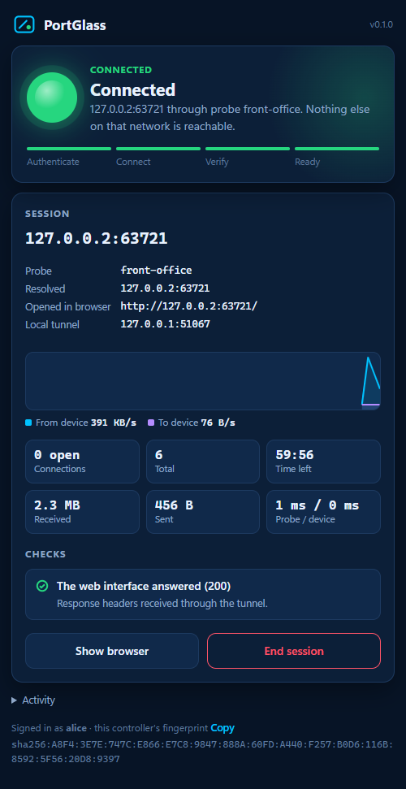

# PortGlass

**Operate one web interface on a remote LAN as if it were on your desk — without a VPN, remote
desktop, or routing a whole network.**

PortGlass v0.4.0 · Windows, and macOS (Apple silicon) for the technician · relay for Linux · MIT · [Docs site](https://spilloid.github.io/portGlass/)

A technician picks a probe, types `192.168.1.50:80`, and a dedicated, isolated browser window
opens on the printer's real web interface. Closing the session closes the tunnel and deletes
everything the browser stored.



> **Guiding principle: expose one explicitly authorized TCP service, not an entire network.**

## How it works

```
 Technician PC                                         Remote site
┌──────────────────────────────┐   TLS 1.3, mutual   ┌──────────────────────┐   plain TCP   ┌─────────┐
│ PortGlass Controller         │   certificate auth  │ PortGlass Probe      │──────────────▶│ printer │
│  • status window             │═════════════════════│  • its own allowlist │  one address, │ :80     │
│  • 127.0.0.1:<random> ◀──┐   │   one port (47100)  │  • sessions expire   │  one port     └─────────┘
│  • session browser ──────┘   │                     │  • audit log         │
└──────────────────────────────┘                     └──────────────────────┘
```

- **PortGlass Probe** runs on an authorized Windows computer at the remote site. It forwards TCP
  only to destinations its administrator listed, only for controllers its administrator
  authorized, for a limited time. It does not run commands, transfer files, scan the network, or
  start automatically.
- **PortGlass Controller** runs on the technician's PC. It authenticates to the probe, asks for a
  session to one destination, exposes it on `127.0.0.1` only, and opens your installed Google
  Chrome with a brand-new profile pointed at the device's own address.

Details: [architecture](docs/architecture.md) · [security model and threat analysis](docs/security-model.md)
· [deployment, firewall and EDR guidance](docs/deployment.md) · [troubleshooting](docs/troubleshooting.md).

### Not on the same network: the relay

When the probe is behind a NAT router and there is no VPN, run **`portglass-relay`** on a server
both sides can reach. The probe and the technician each dial *out* to it. The relay pairs them
and copies their end-to-end encrypted connection, so it can't read or alter anything in it.
Setup takes about ten minutes: [docs/relay.md](docs/relay.md).

```
 Technician PC ──outbound──▶ PortGlass Relay (VPS, TCP 47200) ◀──outbound── Probe (behind NAT)
       └──────────── the same mutual TLS as a direct connection ────────────────┘
```

## Requirements

- **Probe:** Windows 10 or 11 (x64).
- **Technician:** Windows 10 or 11 (x64), or macOS 13+ on Apple silicon (preview — see below).
- Google Chrome installed on the technician's PC. PortGlass does not bundle a browser.
- The technician's PC must reach the probe's TCP port (default 47100): same LAN, or an existing
  authorized VPN. **Or**, for sites you can't reach that way, a [PortGlass Relay](docs/relay.md)
  that both sides can reach, e.g. a small Linux VPS.
- To build from source: Rust (stable, MSVC target) and Visual Studio Build Tools.

## Quick start

**[Download PortGlass for Windows](https://github.com/spilloid/portGlass/releases/latest)** — one zip with the technician program, the probe, and the optional relay. No installer, no admin rights, no scripts. The Linux relay for a VPS is a separate download on the same page.

1. **On your PC**, unzip and double-click **`portglass.exe`**. The PortGlass window opens and shows *Add a probe* with your fingerprint.
2. **On a computer at the remote site**, double-click **`portglass-probe.exe`**. It sets itself up and asks a few questions in its window: paste your fingerprint (who may connect), type the device to allow, like `192.168.1.50` (that allows its http and https ports), and, if you are on another network, the relay to use (Enter skips it). It then prints a one-line **pairing code**. Allow it through Windows Firewall when asked — ideally only for your network.
3. **Back in the PortGlass window**, paste the pairing code and press **Add probe**. The devices the probe allows appear as buttons: press one. (Or type an address and press **Connect**.) The light goes red → amber → green and the device's own page opens in a separate window. **End session** (or closing that window) closes the tunnel and deletes the browser's data.

Everything can also be done from a terminal:

```powershell
portglass init                                    # identity; prints your fingerprint
portglass-probe init --name front-office          # on the probe; prints its fingerprint
portglass-probe authorize --name alice --fingerprint sha256:6A01:...
portglass-probe allow --network 192.168.1.50 --ports 80,443 --label "Front office printer"
portglass-probe run
portglass probe add --name front-office --address 10.0.5.20:47100 --fingerprint sha256:6F59:...
portglass connect --probe front-office --target 192.168.1.50:80
```

### On a Mac

Download `portglass-v0.4.0-macos-arm64.tar.gz` from the release, double-click it to unpack, and open the `portglass` program inside. The Mac build isn't notarized by Apple yet, so the first time macOS refuses to open it: **right-click → Open → Open**, or run `xattr -d com.apple.quarantine portglass` in Terminal. The window and the session browser work as on Windows (Chrome required); it connects to the same Windows probes.

For an administrator-managed install of the probe (Program Files, locked-down ProgramData,
Start menu shortcut, scoped firewall rule) see [deployment](docs/deployment.md).
## Try it on one PC

```powershell
./scripts/build.ps1
./scripts/launch-demo.ps1     # mock printer + probe + controller, all on loopback
```

The demo creates throwaway identities under `%TEMP%`, starts a mock printer interface on
`127.0.0.2:18080`, a probe limited to that address, and the controller window.

## What you get

| | |
|---|---|
| **Secure single-port bridge** | Raw TCP, binary-safe, both directions at once, with backpressure and half-close. HTTP, HTTPS and WebSockets work unmodified. Many concurrent connections to the one authorized target. |
| **Dedicated browser** | Your installed Chrome, a fresh profile per session in `%LOCALAPPDATA%\PortGlass\browser-sessions`, deleted when the session ends. Never your personal profile, no system proxy, no global settings. |
| **The device's own address** | The session window shows `http://192.168.1.50/`, mapped onto the tunnel inside that window only, so Host checks, cookies and same-port redirects behave as on the device's LAN. In strict isolation nothing else resolves. |
| **Genuine status** | Red · amber · green · gray, driven by the session state machine, heartbeats, and the probe test-connecting to the device every 10 seconds. |
| **http and https together** | A session also carries the device's other web port (80 ↔ 443, 8080 ↔ 8443, or wherever it redirects) when the probe allows it, so consoles that switch to HTTPS to sign in just work. Each port is its own probe-approved session. |
| **Diagnostics before you're surprised** | Detects HTTPS, shows the device certificate's fingerprint, and warns when the device redirects to a port the probe doesn't allow. |
| **Signed updates** | Each program says when a newer release exists; one click (or `update`) installs it after checking an Ed25519-signed manifest. Never installs on its own. |
| **Least capability** | The probe's whole command surface is open, check, close, and ping. Anything else is rejected and audited. |
| **Audit** | Both ends log operator, probe, destination, port, session start/end and outcome as JSON lines. Never payloads or credentials. |

## Commands

| Controller (`portglass`) | |
|---|---|
| `portglass` | Open the PortGlass window |
| `portglass init [--operator NAME]` | Create this controller's identity and config |
| `portglass fingerprint` | Print this controller's fingerprint |
| `portglass probe add/list/remove` | Manage pinned probes (`add --relay H:PORT --relay-fingerprint F` for a relayed probe) |
| `portglass connect --probe P --target H:PORT [--no-browser]` | Session from the terminal |
| `portglass diag` | Check config, identity, Chrome, and every probe |
| `portglass probe add --code "portglass:probe?..."` | Pin a probe from its pairing code |
| `portglass update [--check]` | Install (or just look for) a newer signed release |

| Probe (`portglass-probe`) | |
|---|---|
| `portglass-probe init [--name NAME]` | Create config and identity |
| `portglass-probe run` | Run in this console (default) |
| `portglass-probe authorize --name N --fingerprint F` | Authorize a technician |
| `portglass-probe allow --network NET --ports 80,443` | Allow a destination |
| `portglass-probe check-config` | Show the effective policy |
| `portglass-probe diag --target H:PORT` | Check policy and reachability from the probe |
| `portglass-probe fingerprint` / `pairing-code` | Print the probe's fingerprint / its one-line pairing code |
| `portglass-probe update [--check]` | Install (or just look for) a newer signed release |
| `portglass-probe use-relay --address H:PORT --fingerprint F` | Register with a relay (restart to apply) |

| Relay (`portglass-relay`, Linux or Windows) | |
|---|---|
| `portglass-relay init [--name NAME]` | Create config and identity; prints the relay fingerprint |
| `portglass-relay run` | Run in this console (default; SIGTERM-aware for systemd) |
| `portglass-relay authorize --name N --fingerprint F` | Let a probe register |
| `portglass-relay check-config` / `fingerprint` | Show config / print the fingerprint |
| `portglass-relay update [--check]` | Install (or just look for) a newer signed release; then restart the service |

Examples of every configuration file: [`examples/`](examples/).

## Known limitations (v0.4.0)

- **The relay sees metadata.** Which probe and controller fingerprints meet, when, from where, and
  how many bytes. It never sees content. Run it on a machine you control.
- **One device per session.** Its web partner port and redirect targets come along when the probe
  allows them (up to two extra ports). A device that reaches *other* hosts, or ports the probe
  doesn't allow, still can't; PortGlass says when it sees the redirect.
- **HTTPS certificates are the browser's call.** Self-signed device certificates produce Chrome's
  normal warning; PortGlass shows the fingerprint so you can compare. It never disables checks.
- **Chrome shows a notice about `--host-resolver-rules`.** That is the per-window address mapping;
  PortGlass never hides it. Set `preserve_address = false` to avoid the flag (see
  [security model](docs/security-model.md#browser-address-mapping)).
- **No Windows service yet.** The probe runs in a visible console by design for v0.1.0.
- **Signed Windows binaries only.** Windows release builds are Authenticode-signed. The macOS
  controller is not notarized. Every release also carries an Ed25519-signed manifest that the
  built-in updater checks (see [Updates](#updates)); releases before v0.4.0 have no updater.

Full list: [docs/security-model.md#known-limitations](docs/security-model.md#known-limitations).

## Updates

At startup each program asks GitHub once whether a newer release exists. It only *tells* you:
the window shows **Update and restart**, and the probe and relay print a line. Installing is
always your action (`portglass update`, `portglass-probe update`, `portglass-relay update`).
Before installing, PortGlass checks that `portglass-manifest.json` is signed by the PortGlass
release key compiled into it, that the release is newer, and that the download matches the
manifest's SHA-256 and size. Someone who controls the GitHub release or the network can at most
withhold an update, not substitute one. The new version takes effect at the next start; the old
file is kept as `<program>.old` until then. Set `PORTGLASS_NO_UPDATE_CHECK=1` to turn the
startup check off. An administrator install (Program Files, `/usr/local/bin`) needs an
administrator to update it.

## Development

```powershell
cargo test --workspace                                         # unit + integration
cargo test -p portglass-controller -- --ignored                # real Chrome: e2e + UI capture
./scripts/build.ps1 -Release                                   # dist\ with the binaries
```

How work is routed and reviewed: [CLAUDE.md](CLAUDE.md), [docs/dev-process.md](docs/dev-process.md).
Company standards adoption: [docs/standards.md](docs/standards.md). Changes: [CHANGELOG.md](CHANGELOG.md).

## License

MIT © 2026 Joseph Spillers. See [LICENSE](LICENSE).
